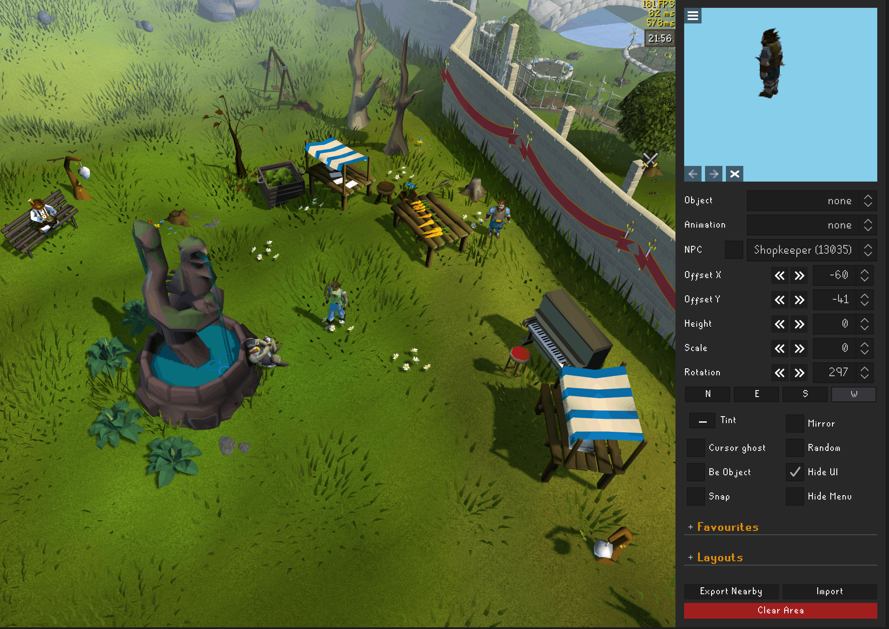

# Map Decorator

Place any object, NPC or light in the game, anywhere. Client-side only: nobody else sees it, and nothing you place touches the server.

## Basics

- Open the panel from the sidebar
- **Shift right-click a tile → Place**. Shift right-click it again for **Edit** and **Remove**
- Up to 6 things per tile, lights included
- Saves automatically

## Finding things

- **Object** - type a few letters to search every named model ("tree", "stool", "fountain")
- **NPC** - search by name. Places with its proper colours and idle animation
- **Animation** - search by what moves ("fire", "flag"). Picking one selects its object for you

## Placing and editing

- Objects land where you clicked within the tile. Turn on **Snap** for dead-centre, good for walls and fences
- **Random** varies rotation and mirror on every placement, for scattering trees and rocks
- Rotation, Height, Offset, Scale, Tint and Mirror all apply to the cursor ghost and the placed object
- **Edit** loads that object's settings, and every control moves it live. **Done** keeps it, **Cancel** puts it back
- 50 steps of undo covering placing, removing, edits, imports and Clear Area

## Player-owned houses

- Works the same inside a POH, saved per account
- An imported layout only lands in rooms that match the house it came from
- Objects on other floors stay hidden until you're on that floor
- In your house, **Clear Area** also offers **Restore Backup**, which puts the house back as it was before your most recent visit that changed it

## Lights (117 HD)

- Needs the **117 HD** plugin. Without it, lights do nothing
- Pick a light from the **Light** dropdown, then shift right-click a tile → **Place Light**
- Every light is one of 117 HD's own spell and effect lights, with its real colour and reach (in tiles, in brackets)
- Height and Offset move it. Scale above 0 makes it brighter, not wider
- Put one on the same tile as a lamp, torch or brazier and the room actually lights up

## Toggles

- **Cursor ghost** - shows your selection under the mouse before you place it
- **Be Object** - hides your player and turns you into the selected object or NPC
- **Hide UI** - clears the interface for screenshots (resizable mode)
- **Hide Menu** - removes the plugin's right-click entries

## Favourites, layouts and sharing

- **Favourites** save the whole recipe: object or NPC, animation, rotation, height, offsets, scale, tint, mirror, light
- **Layouts** keep named export codes between sessions
- **Export Nearby** copies everything within 100 tiles as one code. Someone else stands in the same place and presses **Import**

## Good to know

- **Duplicate an object**: Edit it, press Done. The recipe stays loaded, ready to place again
- Tab and shift-tab move through the panel while editing
- Negative height sinks things into the floor for ruins
- Random plus a handful of trees fills space faster than placing them one at a time
- Decorations are visual only: no collision, and they can't be clicked
- Very large NPCs can clip into terrain
- Saved against your RuneLite profile

Bug or suggestion? Open an issue.
